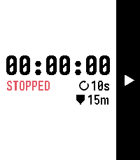
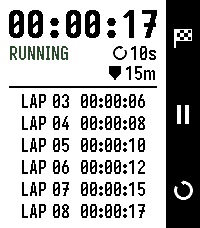
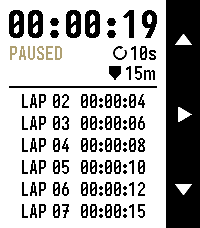
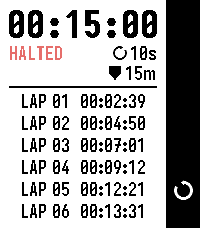
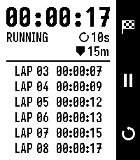
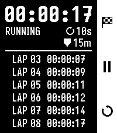
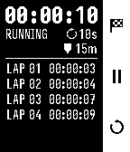

# Eco Stopwatch

A battery-first stopwatch for Pebble. The screen redraws only every N seconds
(default 10) while running, plus once immediately on every button press. An
optional safeguard halts a forgotten timer at a limit you choose, with a buzz
and a phone notification.

## Screenshots

Emery (Pebble Time 2), Color theme, with a 15 minute safeguard set (the
shield and `15m` under the refresh interval):

| Stopped | Running, laps | Paused, scrolling |
|---|---|---|
|  |  |  |

When the timer reaches the safeguard it stops at exactly that time and shows
`HALTED`; only reset (⟲) leaves that state:

| Halted by the safeguard |
|---|
|  |

Other themes, also with the safeguard on: Black on White (emery), White on
Black (emery) and White on Black on a black & white watch (aplite).

| Black on White | White on Black | Aplite |
|---|---|---|
|  |  |  |

## Controls

The right-hand icon bar always shows what the three buttons do.

| Mode | Button 1 (up) | Button 2 (select) | Button 3 (down) |
|---|---|---|---|
| Stopped | n/a | ▶ Start | n/a |
| Running | 🏁 Lap (up to 99) | ⏸ Pause | ⟲ Reset |
| Paused | n/a | ▶ Resume | ⟲ Reset |
| Paused, more laps than fit | ▲ Scroll up | ▶ Resume | ▼ Scroll down |

- The first lap slides the timer to the top and brings up the lap list. The
  newest lap is at the bottom; older laps drop off the top. Reset reverses it.
- Laps show the cumulative time at the press: `LAP 01  00:00:12`.
- While scrolling the lap list, reset is not available: press ▶ to resume
  first, then ⟲.
- Past 100 hours the timer switches to a smaller font. The cap is 999:59:59.
- Back exits the app. State (running, paused, laps) survives exiting.

## Settings

Open the app's settings from the Pebble phone app (Clay page). Changes apply
at once, including on a running timer, and are stored on the watch.

- **Screen Refresh Interval:** 1, 2, 5, 10 (default), 15, 20, 30 or 60 seconds.
  Shown beneath the timer as e.g. `10s`.
- **Safeguard:** None (default), or 5, 10, 15, 30, 45 minutes, or 1, 2, 3, 4, 6,
  8, 12, 24 hours. A running timer that reaches the limit stops at exactly that
  time and shows `HALTED` (orange on the Color theme). Only reset (⟲) leaves
  that state. Laps are kept. A timer that passes the limit while the app is
  closed is halted at the limit on next launch. When enabled, the limit is
  shown under the refresh interval as e.g. `15m` or `2h`. Halting a running
  timer buzzes the watch and posts a phone notification (via the phone app, so
  it needs the phone connected; no notification when halted at launch).
- **Color Theme:** White on Black, Black on White, and (color watches only)
  Color: Black on White with a colored state verb (STOPPED red, RUNNING green,
  PAUSED yellow, HALTED orange; darker shades so they stay readable on white). Black & white
  watches (aplite, diorite, flint) offer only the first two.

## Battery design

- One `app_timer` wakeup per interval, aligned to the interval boundary of
  elapsed time (the display reads :00, :10, :20, ...).
- No timers at all while stopped, paused, or while the app is covered (for
  example by a notification); the timer is re-armed on focus.
- No tick service, backlight, vibration or wakeups.
- Elapsed time is derived from wall-clock timestamps, never from counted
  ticks, so it stays exact at any interval and while the app is closed.
- Settings and timer state are written only on change/exit.

## Platforms

aplite, basalt, chalk, diorite, emery, flint, gabbro.

| | aplite / basalt / diorite / flint | chalk | emery | gabbro |
|---|---|---|---|---|
| Lap rows visible | 6 | 4 | 7 | 6 |
| Timer font (shrunk) | 26 (22) | 26 (22) | 38 (34) | 38 (34) |
| Subtext font | 14 | 14 | 18 | 18 |

Round screens (chalk, gabbro) show fewer rows because of the bezel.

## Build

```sh
unset CFLAGS            # if your shell exports host CFLAGS (e.g. -march=native)
pebble build
pebble install --emulator emery
pebble emu-app-config --emulator emery   # open the Clay settings page
```

Settings use the `@rebble/clay` package (`pebble package install @rebble/clay`),
not `pebble-clay`, which does not build for flint or gabbro. Set
`ECO_DEBUG_LOG` to `1` in `src/c/config.h` to log each refresh.

## Fonts

Iosevka Custom for Pebble, in `resources/fonts/`:

- `IosevkaCustomForPebble-Heavy.ttf` for the timer.
- `IosevkaCustomForPebbleNarrow-Regular.ttf` for the subtext and lap rows.

Each is subset with `characterRegex` (`[0-9:]` for the timer, `[ 0-9:A-Zs]` for
the text), so every font resource is only about 2 KB.
